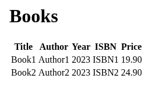

# BookStore

A small bookstore web app in Spring Boot. It has a `Book` entity (title, author, publication year, ISBN, price), a Spring Data repository and an in-memory H2 database. It saves 2 placeholder books at startup and lists them in a Thymeleaf table at `/` and `/bookStore`.



The book list at `/bookStore`. Screenshot from a local run of the fixed code, 25 October 2026.

Stack: Java 17, Spring Boot 3.1.3, Spring Data JPA, Thymeleaf, H2, Maven wrapper.

Run:

```
./mvnw spring-boot:run       # macOS / Linux
mvnw.cmd spring-boot:run     # Windows
```

Then open http://localhost:8080/. The H2 console is on at `/h2-console`, JDBC URL `jdbc:h2:mem:testdb`, user `sa`, empty password. Spring Boot only lets it accept connections from the same machine.

Test: `./mvnw verify` runs a MockMvc test of the list page.

Not finished:
- Only the list page. There are no forms to add, edit or delete books.
- Spring Boot 3.1.x has been out of open source support since May 2024. Fine for a course exercise, not for anything deployed.

Status: back-end course exercise, 2 commits on 6 and 7 September 2023. Review fixes in October 2026: the list page, the missing JPA constructor, the seed data, the Thymeleaf starter and the `mvnw` executable bit.
